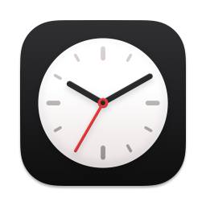
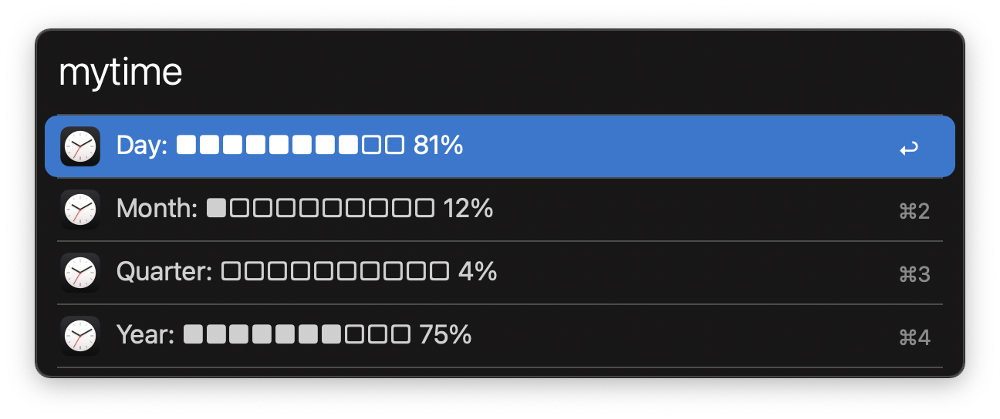

#  Time Progress Alfred Workflow

Check your time progress at a glance

[⤓ Download the workflow](https://github.com/iAli/time-progress-workflow/releases/latest)

## Usage

Check your day, month, quarter, and year progress via the `mytime` keyword.

